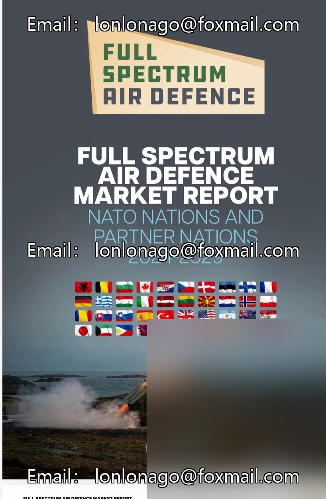
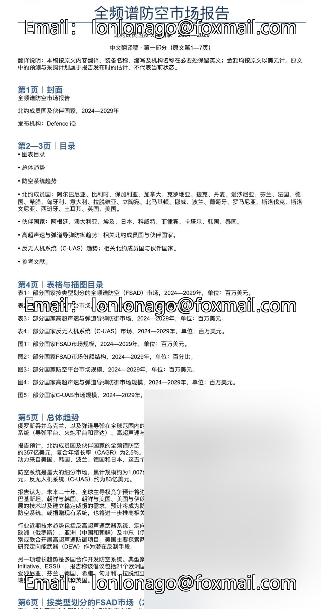

# Full-spectrum air defense market report Chinese version

## Body

Full Spectrum Air Defence Market Report Chinese Edition 2024-2029
Free Chinese translation available
Issued January 2024, with English PDF version, totaling 120 pages.
Content covers full spectrum air defence market analysis for NATO and partner countries, provides detailed data such as equipment procurement plans, investment scales, and technical roadmaps for various countries, applicable to defense industry, military consulting, market research, and policy formulation fields.
free upon sale.

The full-spectrum air defence market report includes Chinese translation, analysis covering NATO nations and partner countries, detailed data on equipment procurement plans, investment scale, technical roadmaps, applicable to defence industry, military consulting, market research and policy formulation.

<!-- AI_ENRICHED -->

## Images

## Payment

Here is a pay link on Stripe ( https://buy.stripe.com/3cs8yP7sY87d0vu9AB ). Please contact me lonlonago@foxmail.com after funding $89, and I will send you a complete data files , thank you!

